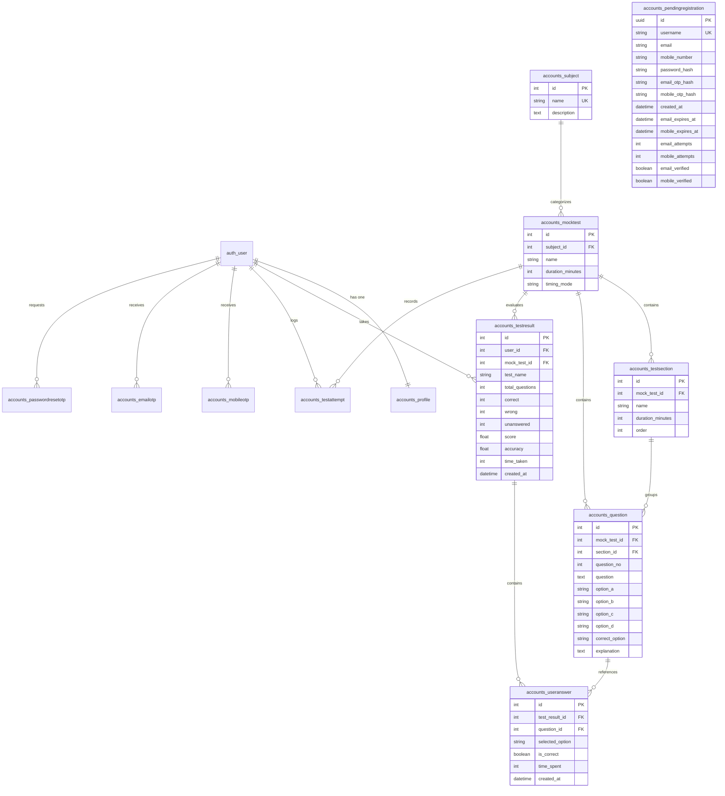

# Document 4: Database Audit & Data Migration Assessment

**Project Name:** EduMind  
**Audit Date:** November 2026  
**Auditor Role:** Database Architect & Senior Django Backend Engineer  

---

## 1. Existing Database Configuration & Schema

### Active Database Configuration
- **Engine:** `django.db.backends.sqlite3`
- **File:** `db.sqlite3` (Size: 1,191,936 bytes / ~1.19 MB)
- **Migrations:** 22 migration files executed in `accounts/migrations/`

### Entity-Relationship Diagram



---

## 2. Table-by-Table Data Audit (from Live `db.sqlite3`)

| Table Name | Record Count | Data Classification | Observations & Health Check |
|---|---|---|---|
| `auth_user` | 14 | Operational / Test Users | Contains 2 superusers (`ROHIT.M`, `Rohit.M`) and 12 test student users. Password hashes are Django PBKDF2 SHA256. |
| `accounts_profile` | 14 | Operational Profile Data | Stores mobile numbers associated with `auth_user`. |
| `accounts_subject` | 9 | Master Seed Data | CAT, BANK, SSC, RAILWAY, QA, Reasoning, English, GK, Olympiad. |
| `accounts_mocktest` | 64 | Master Mock Tests | 64 mock tests assigned to various subjects. `duration_minutes` defaults to 60. |
| `accounts_testsection` | 0 | Unused Feature Data | Table exists (created by migration 0021), but has 0 records. Sectional testing is not actively seeded. |
| `accounts_question` | 3,216 | Live Question Bank | 3,216 question records. Average ~50 questions per active mock test. Populated with options A-D, answers, and explanations. |
| `accounts_testresult` | 54 | User Exam Results | 54 completed tests. Note: 14 earlier records have `mock_test_id = NULL` (legacy attempts created before foreign key was added in migration 0017). |
| `accounts_useranswer` | 3,239 | Granular Answers | 3,239 user question responses linked to `TestResult` records. |
| `accounts_testattempt` | 17 | Score History | Duplicate historical ledger introduced in migration 0015. Redundant with `TestResult`. |
| `accounts_mobileotp` | 4 | Transient Auth Logs | Test records for mobile OTP codes. |
| `accounts_emailotp` | 0 | Transient Auth Logs | Zero records; replaced by `PendingRegistration`. |
| `accounts_passwordresetotp` | 6 | Transient Auth Logs | Test password reset requests. |
| `accounts_pendingregistration`| 0 | Transient Auth Logs | Clean (no pending unverified registrations in database). |
| `django_admin_log` | 409 | Audit Log | 409 admin audit records tracking manual edits to questions and subjects. |

---

## 3. Analysis of `backup_data.json`

A file named `backup_data.json` (35,135 bytes) is present in the project root. A detailed binary and textual inspection revealed:

1. **File State: CORRUPTED & TRUNCATED**
   - The file abruptly ends at byte 35,135 with an unterminated JSON string:
     `... "action_flag": 2, "change_message": "[]"}}, {"model": "admin.logentry", "pk": 141, "fields": {"action_time": "2026-10-07T08:12:11.311Z", "user": 1, "content_type": 7, "object_id": "1439", "object_repr": `
   - The trailing closing bracket `]` and final object curly braces are missing.
2. **Encoding Issues:** Contains invalid byte sequences (e.g. byte `0xd7` representing multiplication sign `×` in Latin-1/CP1252 rather than valid UTF-8).
3. **Data Scope:** It is **NOT** a full database dump. It contains solely 141 records of `admin.logentry` (Django Admin change history). It contains **0 users, 0 questions, 0 mock tests, and 0 test results**.
4. **Conclusion:** `backup_data.json` is a failed, truncated export of Django admin logs and is **completely unusable for database restoration**.
5. **Safe Source of Truth:** The actual operational data is located in `db.sqlite3` (1.19 MB), which is intact and fully queryable.

---

## 4. PostgreSQL Migration Assessment & Compatibility Plan

Migrating from SQLite3 to PostgreSQL on Ubuntu VPS is technically required before production deployment.

### Compatibility & Schema Risks

1. **Nullable Foreign Keys & Legacy Data:**
   - In `accounts_testresult`, 14 records have `mock_test_id IS NULL`. The Django model currently defines:
     `mock_test = models.ForeignKey('MockTest', on_delete=models.CASCADE, related_name='results', null=True, blank=True)`
     If anyone alters `null=False` in future migrations, data integrity checks in PostgreSQL will fail.
2. **UUID Primary Keys:**
   - `PendingRegistration` and `PasswordResetOTP` use `models.UUIDField(primary_key=True)`. PostgreSQL has native `uuid` column support, which is fully compatible with Django's PostgreSQL backend.
3. **Floating Point Precision:**
   - In `TestResult`, `score` and `accuracy` use `models.FloatField`. Floating point calculations can introduce rounding quirks (e.g., `2.9999999999999996`). For financial or exact competitive examinations, `DecimalField(max_digits=6, decimal_places=2)` is recommended in Phase 2 refactoring.
4. **Case Sensitivity:**
   - SQLite `LIKE` queries are case-insensitive by default. PostgreSQL `LIKE` is strictly case-sensitive, while `ILIKE` is case-insensitive. Django handles this transparently when using `__icontains`, but any raw SQL or manual queries must be audited.

### Recommended Data Migration Procedure

Do **NOT** use `backup_data.json`. The proper path to PostgreSQL is:

1. **Install Driver:** Add `psycopg2-binary>=2.9.9` to `requirements.txt`.
2. **Clean SQLite Dump:**
   Export intact operational data from `db.sqlite3` using Django's native fixture tool, excluding content types and permissions to prevent collision:
   ```bash
   python manage.py dumpdata accounts --natural-foreign --natural-primary --indent 2 > clean_accounts_data.json
   python manage.py dumpdata auth.User --natural-foreign --natural-primary --indent 2 > clean_users_data.json
   ```
3. **Provision PostgreSQL Database:**
   ```sql
   CREATE DATABASE edumind_db;
   CREATE USER edumind_user WITH PASSWORD 'secure_random_password';
   ALTER ROLE edumind_user SET client_encoding TO 'utf8';
   ALTER ROLE edumind_user SET default_transaction_isolation TO 'read committed';
   ALTER ROLE edumind_user SET timezone TO 'Asia/Kolkata';
   GRANT ALL PRIVILEGES ON DATABASE edumind_db TO edumind_user;
   ```
4. **Run Migrations on PostgreSQL:**
   Switch `settings.DATABASES` to PostgreSQL and run `python manage.py migrate`.
5. **Import Data:**
   ```bash
   python manage.py loaddata clean_users_data.json
   python manage.py loaddata clean_accounts_data.json
   ```

