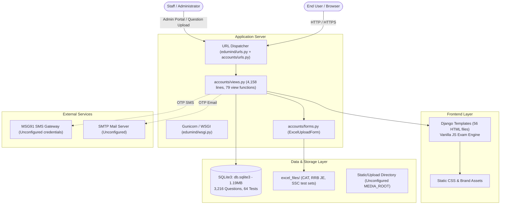

# Document 1: Project Overview & Technology Discovery

**Project Name:** EduMind  
**Audit Date:** November 2026  
**Auditor Role:** Senior Software Architect, Django Backend Engineer, Frontend Engineer, Database Architect & DevOps Engineer  
**Audit Type:** Read-Only Static Code Discovery & Architecture Inspection  

---

## 1. Executive Summary

EduMind is an online examination and test-preparation platform built with Python and Django. It provides multi-category competitive exam preparation (CAT, Banking [SBI, IBPS, RRB, RBI], SSC [CGL, CHSL, JE, MTS, GD, CPO, Stenographer], Railway [RRB JE, ALP, NTPC, Group D], and School Olympiads). The system provides mock test administration, countdown timers, question-by-question navigation, test review, automated score calculation with negative marking, test ranking leaderboards, and performance analysis dashboards.

The codebase was constructed using AI-assisted tools by a non-technical developer. While visually comprehensive and featuring extensive mock test views, the application exhibits classic AI-assisted generation patterns:
1. Massive code duplication and copy-paste view logic across a single monolithic `accounts/views.py` (4,158 lines).
2. Critical security vulnerabilities, including full client-side question answer leakage (correct options sent directly to browser JSON during exam taking).
3. Hardcoded secrets and development flags enabled in production settings (`DEBUG = True`, hardcoded `SECRET_KEY`, unconstrained `ALLOWED_HOSTS = ["*"]`).
4. Duplicate function definitions in views causing dead code.
5. Incomplete third-party integrations (SMS OTP uses MSG91 API configuration which is missing from `settings.py`, and email sending defaults are unconfigured).
6. Corrupted database export artifact (`backup_data.json` is a truncated 35 KB file with improper encoding and unclosed JSON array, while the primary database `db.sqlite3` is intact at 1.19 MB).

---

## 2. Technology Stack & Exact Versions

| Component | Technology | Version / Specification | Verification Source |
|---|---|---|---|
| **Language** | Python | 3.13.5 (configured in original venv), tested on 3.14.3 | `venv/pyvenv.cfg`, host runtime |
| **Framework** | Django | 6.0.7 | `requirements.txt`, `edumind/settings.py` |
| **ASGI/WSGI** | ASGI / Gunicorn | `asgiref==3.11.1`, `gunicorn==26.0.0` | `requirements.txt` |
| **Excel Ingestion** | openpyxl / et_xmlfile | `openpyxl==3.1.5`, `et_xmlfile==2.0.0` | `requirements.txt`, `accounts/views.py` |
| **SQL Parsing** | sqlparse | `sqlparse==0.5.5` | `requirements.txt` |
| **Timezone Data** | tzdata | `tzdata==2026.3` | `requirements.txt` |
| **Database Engine** | SQLite3 (configured) | SQLite 3 (`BASE_DIR / 'db.sqlite3'`) | `edumind/settings.py` |
| **Target Database** | PostgreSQL | Planned for production | Task Specification |
| **Frontend Core** | HTML5, CSS3, Vanilla JavaScript | Native JS (no React/Vue/Angular build pipeline) | `templates/`, `static/` |
| **External JS Libs** | MathJax / FontAwesome | Loaded via CDN in select templates | `templates/base.html`, `test.html` |
| **SMS Service** | MSG91 Flow API | REST API (`https://control.msg91.com/api/v5/flow/`) | `accounts/views.py` (L3650-L3690) |
| **Email Service** | Django `send_mail` | Standard SMTP (unconfigured in `settings.py`) | `accounts/views.py` (L3636) |

### Dependency Analysis

From `requirements.txt`:
```text
asgiref==3.11.1
Django==6.0.7
et_xmlfile==2.0.0
gunicorn==26.0.0
openpyxl==3.1.5
packaging==26.2
sqlparse==0.5.5
tzdata==2026.3
```

#### Observations:
- **Missing Database Driver:** For PostgreSQL deployment, `psycopg2-binary` or `psycopg[binary]` is missing.
- **Missing Environment Management:** No `python-dotenv` or `django-environ` is installed; settings are raw and static.
- **Missing HTTP Client:** `requests` is imported in `accounts/views.py` (L3679) for MSG91 SMS dispatch, but `requests` is **omitted from `requirements.txt`**. If deployed in a clean container or virtual environment, calling SMS functions will raise `ModuleNotFoundError: No module named 'requests'`.
- **Missing Production Static Handler:** `whitenoise` is not installed, though Nginx can handle static files in production.

---

## 3. High-Level System Architecture



---

## 4. Repository & Directory Structure

```text
edumind/
├── .github/
│   └── workflows/
│       └── static.yml           # GitHub Pages deployment workflow (misconfigured for Django)
├── accounts/                   # Primary Django Application Module
│   ├── migrations/             # 22 Django database migration files
│   ├── admin.py                # Model admin registrations
│   ├── apps.py                 # AppConfig ('accounts')
│   ├── forms.py                # ExcelUploadForm
│   ├── models.py               # 11 Models (Subject, MockTest, Question, TestResult, etc.)
│   ├── tests.py                # Blank test suite (empty file)
│   ├── urls.py                 # 52 URL patterns
│   ├── views.py                # Monolithic 4,158-line views module
│   └── views_backup.py         # 102 KB backup file checked into repository
├── edumind/                    # Django Project Root Configuration
│   ├── __init__.py
│   ├── asgi.py
│   ├── settings.py             # Settings (Debug=True, hardcoded SECRET_KEY)
│   ├── urls.py                 # Root URLConf
│   └── wsgi.py                 # WSGI entry point for Gunicorn
├── excel_files/                # Question Bank Ingestion Files
│   ├── CAT/                    # 38 Excel files for CAT
│   ├── RRB JE/                 # 6 Excel files for Railway RRB JE
│   └── SSC/                    # 20 Excel files for SSC (CGL, CHSL, MTS, JE)
├── static/                     # Global static assets (CSS, images, icons)
├── templates/                  # 56 HTML templates (Exam UI, Dashboards, Landing pages)
├── venv/                       # Checked-in Windows Virtual Environment (C:\Python313)
├── backup_data.json            # 35 KB corrupted/truncated JSON fixture
├── db.sqlite3                  # 1.19 MB SQLite database with operational test data
├── edumind.zip                 # 6.3 MB full zip archive copy checked into repository
├── manage.py                   # Django CLI entrypoint
├── requirements.txt            # Python dependencies (UTF-16 LE encoded)
└── Documentation/Draft docx:   # Codes.docx, Home.docx, Performanace_analysis.docx, Test View.docx
```

---

## 5. Entry Points and Configuration

1. **`manage.py`**: Standard Django entry point invoking `edumind.settings`.
2. **`edumind/wsgi.py`**: Entry point for WSGI servers like Gunicorn.
3. **`edumind/asgi.py`**: Entry point for ASGI servers (Daphne, Uvicorn).
4. **`edumind/settings.py`**:
   - `BASE_DIR`: Resolved via `Path(__file__).resolve().parent.parent`.
   - `INSTALLED_APPS`: Contains standard Django apps and single app `'accounts'`.
   - `MIDDLEWARE`: Default Django middleware chain (Security, Sessions, Common, CSRF, Auth, Messages, XFrameOptions).
   - `DATABASES`: Configured exclusively for SQLite3 (`BASE_DIR / 'db.sqlite3'`).
   - `STATIC_URL`: `'static/'` with `STATICFILES_DIRS = [BASE_DIR / 'static']` and `STATIC_ROOT = BASE_DIR / 'staticfiles'`.
   - `MEDIA_URL` / `MEDIA_ROOT`: **Completely missing**. File uploads for question Excel files are processed in-memory or in temp files without a declared media root.

