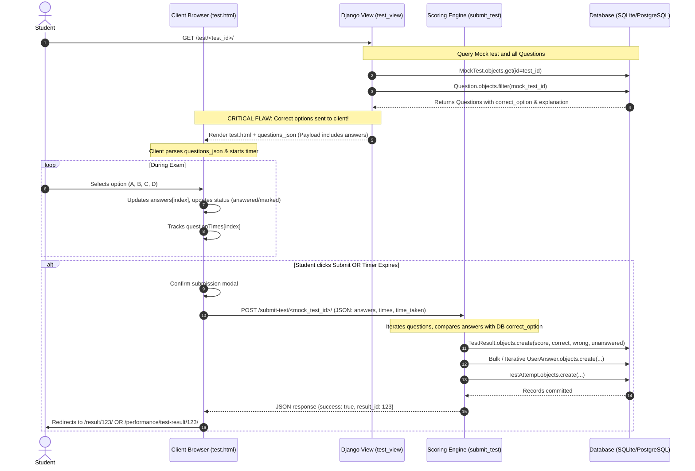

# Document 3: User Roles and Application Flows

**Project Name:** EduMind  
**Audit Date:** November 2026  
**Auditor Role:** Senior Software Architect & Lead Full-Stack Engineer  

---

## 1. User Roles & Permission Model

The application defines two practical user roles using Django's built-in `auth.User` attributes:

| Role | Identification | Access Capabilities | Enforced By |
|---|---|---|---|
| **Student (Candidate)** | `is_authenticated == True`, `is_staff == False` | Browse exam catalogs, launch tests, take examinations, submit tests, review results, view performance analytics, view rankings. | `@login_required` decorators on student views. |
| **Administrator / Teacher** | `is_staff == True` or `is_superuser == True` | All student capabilities + question ingestion portal (`/upload_questions/`), standard Django Admin (`/admin/`). | `request.user.is_staff` check in `upload_questions` and Django Admin backend. |
| **Anonymous (Guest)** | `is_authenticated == False` | View landing home page (`/`), view login (`/login/`), registration (`/register/`), forgot password (`/forgot-password/`), static exam listings. | Redirect to `LOGIN_URL` ('login'). |

> [!NOTE]
> There is **no dedicated Teacher role** distinct from Admin. There are no role-based permission groups (`auth_group` has 1 unused group; `auth_user_groups` is empty). Teachers and Admins are conflated into `is_staff`.

---

## 2. Examination Workflow

The core functionality of EduMind is the examination delivery lifecycle.

### Detailed Breakdown of Examination Steps

1. **Test Selection & Instructions:** Student navigates from category/subject catalog to a specific mock test. The student can view test name and time limit.
2. **Test Initialization:** Request hits `test_view(request, test_id)`. The view fetches all questions belonging to `mock_test` and dumps them into `questions_json` via `json.dumps(questions_data)`.
3. **Execution & Answer Tracking:**
   - Client JS stores questions in an array `questions`.
   - Timer counts down every 1 second (`setInterval`).
   - Answers are stored in a simple JavaScript index array: `answers = [0, 2, null, 1, ...]`.
   - Per-question dwell time is tracked in `questionTimes = [15, 42, 10, ...]`.
   - Palette indicates question state: Not Visited (gray), Visited/Unanswered (red), Answered (green), Marked for Review (purple).
4. **Submission Handling:**
   - Submission can occur manually via the "Submit Test" button or automatically when `timeRemaining <= 0`.
   - Browser fires `fetch("/submit-test/<mock_test_id>/", {method: "POST", body: JSON.stringify({...})})`.
5. **Backend Processing & Result Calculation:**
   - In `submit_test`, answers are compared with database records.
   - For regular exams: `score = (correct * 3) - (wrong * 1)`.
   - For RRB ALP exams: `score = correct - (wrong / 3)`.
   - `accuracy = (correct / attempted) * 100`.
   - Creates records in `TestResult`, `UserAnswer` (one record per question), and `TestAttempt`.
6. **Post-Exam Review:**
   - User views detailed breakdown: question text, options, selected option, correct option, and explanation.

---

## 3. Disconnected and Inconsistent User Flows

```mermaid
flowchart TD
    subgraph Registration Disconnection
        R1[Student fills Register Form] --> R2[POST /register/]
        R2 --> R3[Creates PendingRegistration]
        R3 --> R4{MSG91 Configured?}
        R4 -- No --> R5[Runtime Error 500 / Crash]
        R4 -- Yes --> R6[Sends SMS & Email OTP]
        R6 --> R7[verify-registration page]
        R7 --> R8[User submits OTPs -> User Created]
    end

    subgraph Result View Inconsistency
        S1[Submit Test] --> S2[Returns result_id]
        S2 -.-> R_A["Option A: /result/<id>/ (result_detail.html)"]
        S2 -.-> R_B["Option B: /performance/test-result/<id>/ (test_result_detail.html)"]
        R_A --- Inconsistent["Duplicate templates with inconsistent styling and layout"]
    end

    subgraph Navigation Dead Ends
        B1["Bank / SSC Landing Pages (e.g., bank_ibps_po.html)"] --> B2["Cards contain href='#'"]
        B2 --> B3["Dead End: Clicks do not navigate to active mock tests"]
    end
```

### Flow Deficiencies Identified:
1. **Double Submission Window:** In `test.html`, when `submitTest()` is triggered by timer expiration, there is no synchronous lock prior to the asynchronous `fetch` call. If a student rapidly clicks submit right as timer expires, parallel POST requests can be issued.
2. **Lack of Mid-Exam Persistence:** Answers are stored purely in client-side JavaScript memory (`answers` array). If a candidate refreshes the page, experiences browser crash, or loses connectivity, **all answers and elapsed times are lost immediately**.
3. **Inconsistent Result Redirection:** `test.html` JavaScript redirects to `result_detail` (`/result/<id>/`), while the performance dashboard routes to `test_result_detail` (`/performance/test-result/<id>/`). Both views render different HTML templates with divergent CSS and data schemas.
4. **Dead Ends in Category Browsing:** Over 12 exam category templates (`bank_rrb_po.html`, `bank_sbi_po.html`, `ssc_chsl.html`, etc.) feature visual lists of tests where action buttons are hardcoded to `href="#"`.

